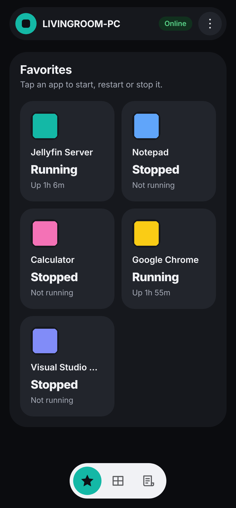
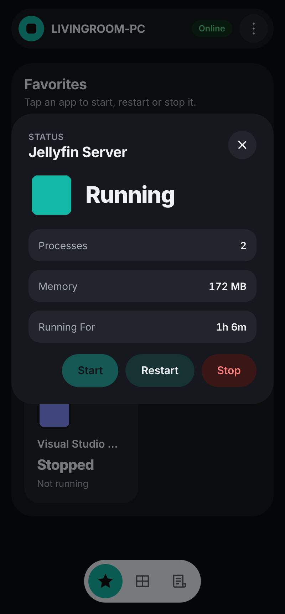
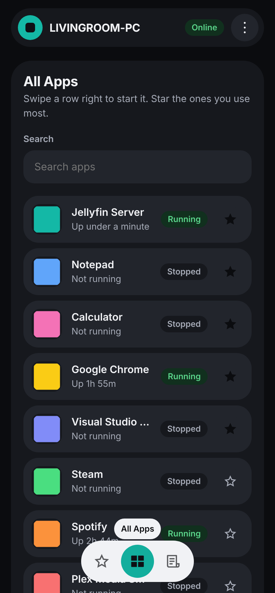
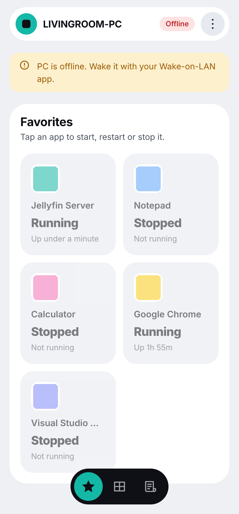
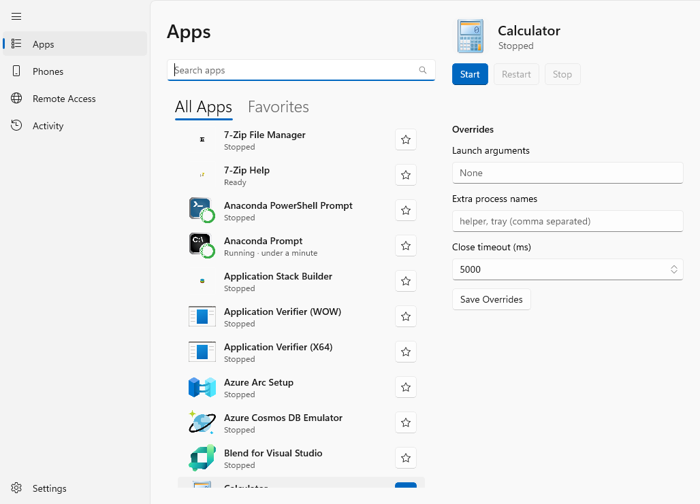
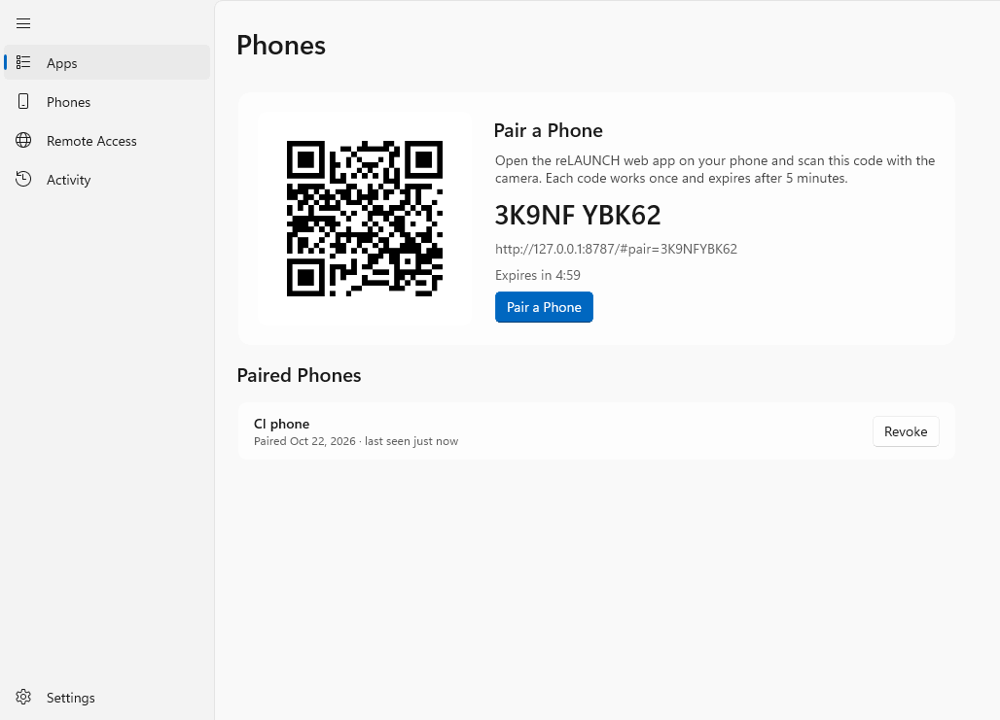

# reLAUNCH

Launch, stop and restart apps on your Windows 11 PC from your phone, even while the PC is locked and when you are away from home.

Made for moments like this: Infuse on the TV can't reach the Jellyfin server → open reLAUNCH on your phone → tap **Jellyfin** → **Restart**.

| Favorites | App card | All apps | PC offline (light) |
|---|---|---|---|
|  |  |  |  |

_(Phone screenshots use example apps and a simulated PC.)_

Desktop app (captured from the CI runner):  

## How it works

```
Phone (web app) ──HTTPS──► Cloudflare Worker relay (free) ◄──outbound WebSocket── your PC
                                                                 reLAUNCH service (Windows service)
                                                                   └─ agent in your signed-in session
                                                                 reLAUNCH desktop app (settings)
```

- **Desktop part (on the PC):** a Windows service starts a small helper in your signed-in Windows session. The helper reads the Start menu app list, launches apps, and closes them (politely first, then forcefully). Because your session keeps running when locked, everything works behind the lock screen.
- **Relay:** a free Cloudflare Worker. The PC keeps an outbound connection to it, so you need no port-forwarding, no VPN and no domain.
- **Phone:** an installable web app. No app store, no software on the phone.
- It can only start, stop and restart apps from the PC's own Start menu list. It never runs arbitrary commands or paths.

Not covered on purpose: waking a sleeping PC (use your Wake-on-LAN tool) and apps that need administrator rights.

## Install

1. **PC:** download `ReLaunchSetup.msi` from the latest successful run of the *build* workflow (Actions → run → Artifacts → `reLAUNCH-installer`) and run it. It installs the **reLAUNCH** service (starts automatically, restarts itself after a crash) and adds **reLAUNCH** to the Start menu.
2. **Relay:** follow [docs/SETUP-CLOUDFLARE.md](docs/SETUP-CLOUDFLARE.md) (about 10 minutes, free).
3. **Phone:** in the desktop app open **Phones → Pair a Phone** and scan the QR code. Optionally *Add to Home Screen*.

## Use

- **Favorites:** tap an app tile; a card opens with **Start**, **Restart** and **Stop**. Stop asks for confirmation. Status words change live (Starting, Running, Stopped) and a toast confirms ("Jellyfin restarted").
- **All Apps:** search, star the apps you want in Favorites, or swipe a row to the right to start it.
- **Activity:** the latest actions, which phone did them, and the result.
- **PC offline / locked / nobody signed in:** the top bar says so. Offline, your favorites stay visible but greyed out. Wake the PC and the phone updates by itself.

### Jellyfin

If the app list contains **Jellyfin Server**, reLAUNCH treats the tray app (`Jellyfin.Windows.Tray`) and the server (`jellyfin`) as one app: Restart stops both and starts the tray app again.

### Desktop app pages

**Apps** (search, favorites with drag-to-reorder, per-app launch arguments, extra process names and close timeout, test buttons) · **Phones** (pair, list, revoke) · **Remote Access** (relay URL, PC key, connection state) · **Activity** · **Settings** (start with Windows, debug API).

## Troubleshooting

| You see | What to do |
|---|---|
| Desktop app says it can't reach the service | Start the **reLAUNCH** service in Windows *Services*, or reinstall. |
| Remote Access shows **Rejected key** | The relay's `PC_KEY` differs from this PC's key. Set the same key on both and redeploy. |
| Phone shows **Offline** | The PC is off, asleep or has no internet. Wake it; the phone recovers without reloading. |
| Phone shows **No Session** | Nobody is signed in on the PC. Apps need a Windows session; lock is fine, signed-out is not. |
| "needs administrator rights" | The app runs elevated; v1 cannot start those. |
| Phone says "disconnected" | The phone was revoked on the PC. Pair it again. |

Debug HTTP API (off by default): turn it on in **Settings**, restart the service, then `curl http://127.0.0.1:5480/api/apps`.

## Repository

| Path | What |
|---|---|
| `src/ReLaunch.Core` | Shared models, restart state machine, catalogue matching, pipe protocol |
| `src/ReLaunch.Agent` | Headless helper in the user session (shell enumeration, icons, launch, close) |
| `src/ReLaunch.Service` | Windows service: agent supervisor, SQLite, relay client, pipe server, debug API |
| `src/ReLaunch.App` | WinUI 3 desktop app |
| `relay/` | Cloudflare Worker (`PcHub` Durable Object) and the phone web app (`relay/web`, built into `relay/public`) |
| `installer/` | WiX MSI |
| `docs/` | [PLAN](docs/PLAN.md), [STATUS](docs/STATUS.md), [Cloudflare setup](docs/SETUP-CLOUDFLARE.md) |

Every push is built, tested and packaged on GitHub Actions (`windows-latest` plus `ubuntu-latest`). The Windows job also runs the service, agent and desktop app on the runner, runs a local relay end to end, installs the MSI for real and uninstalls it again.

To work on the phone web app: `cd relay && npm ci && python3 web/build.py` (rebuilds `relay/public` with the S4 Flat kit in `relay/web/s4-flat`), `npm test`, `npx wrangler dev`.
